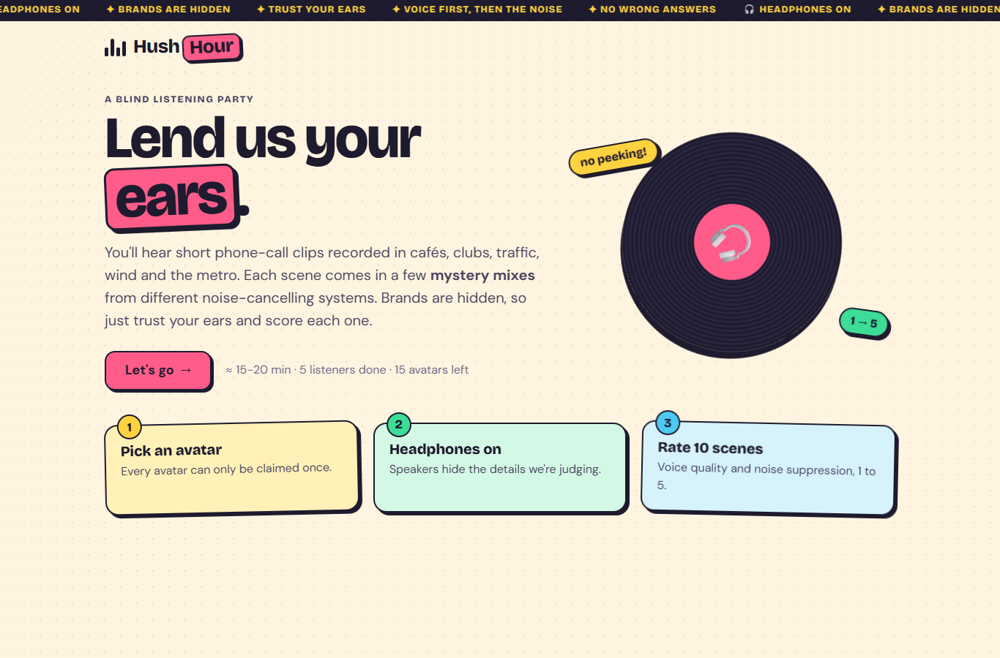
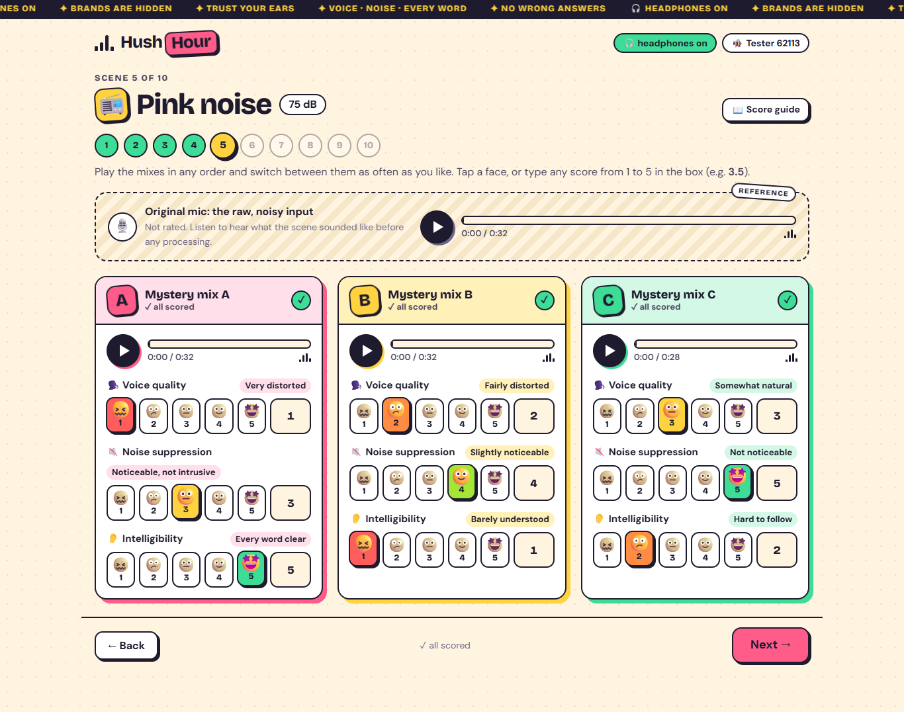

# 🎧 Hush Hour: a blind listening test for noise suppression

A small website where listeners rate phone-call clips **1–5 on voice quality, noise suppression and intelligibility**, without knowing which system produced each clip. It runs on GitHub Pages, and the votes go into a private Google Sheet through a small Apps Script.




## What a listener does

1. **Picks a name and an avatar.** There are 20 avatars and each can be claimed by only one person.
2. **Headphones on.** They say what they're wearing (over-ear, on-ear or in-ear, wired or Bluetooth) and can play a left/right ear-check beep.
3. **Rates 10 scenes.** Each scene (for example "Café · 75 dB") shows:
   - the **original noisy mic recording** as an unrated reference, when one exists;
   - 2–3 **mystery mixes** labelled A/B/C, in a different random order for every listener.

   Each mix gets three scores: 🗣️ **voice quality**, 🔇 **noise suppression** and 👂 **intelligibility**. A listener can tap a face (1–5) or type any number from 1 to 5, such as `3.5` or `4.25`. Mixes can be played in any order and switched between freely, with no listening minimum. Back, Next and the numbered scene dots let listeners move around, and progress is saved in the browser, so a reload loses nothing.
4. **Reviews and submits.** After submitting, that person is done: the same browser, name and avatar can't rate again.

## How blinding works

| Where | What it contains |
|---|---|
| `audio/*.wav` (public) | clips renamed to random ids like `s_5h34hu2y.wav` |
| `data/vectors.json` (public) | scenes, the clip ids in each scene (shuffled), and the reference clip id |
| Google Sheet → `Ratings` tab | one row per scored clip, by clip id only |
| **Private** `Key.gs` / `key.csv` | clip id → device. Only in your Apps Script project and your private folder, **never in this repo** |

Device names appear only on the organiser's admin page and in the sheet's results tabs.

## How scenes are shared out

Each listener gets `PER_RATER` scenes (default 10). They are picked from the **least-covered scenes first**, mixing noise types, so coverage stays even:

| Listeners | Ratings per scene (33 scenes) |
|---|---|
| 4 | every scene at least once |
| 5–6 | every scene 1–2× |
| 12 | every scene 3–4× |

A session that's started but not finished reserves its scenes for 3 hours and its avatar for 12 hours, then both are released.

---

## Setup (about 10 minutes)

### 1. Build the blind dataset (already done for this benchmark)

```bash
python tools/build_dataset.py --src <folder with Noise_Level_Device.wav clips> \
    --private ../hush-hour-PRIVATE --devices DevA,DevB,DevC \
    [--reference Input] [--ignore SomeOtherInput] [--merge Cafe_85dB=Cafe_80dB]
```

This fills `audio/` and `data/vectors.json`, and writes `key.csv` + `Key.gs` into the private folder. The private folder must be **outside** this repo. Running it again would give every clip a new id and break any ratings already collected, so the script refuses unless you add `--force`.

### 2. Create the Google Sheet backend

1. Create a new, empty Google Sheet (for example "Hush Hour results").
2. Open **Extensions → Apps Script**.
3. Replace the contents of `Code.gs` with [`apps-script/Code.gs`](apps-script/Code.gs).
4. Click **+ → Script**, name it `Key`, and paste in the contents of your **private** `Key.gs`.
5. Save. Choose `setup` in the function dropdown, click **Run**, and approve the permissions. The execution log prints your **admin key**. You can also find it later in the sheet under **🎧 Hush Hour → Show admin key**.
6. Click **Deploy → New deployment**, choose the type **Web app**, and set
   - Execute as: **Me**
   - Who has access: **Anyone**

   Click **Deploy** and copy the URL that ends in `/exec`.

### 3. Connect the site

Paste the `/exec` URL into [`config.js`](config.js):

```js
API_URL: 'https://script.google.com/macros/s/AKfy.../exec',
```

### 4. Publish on GitHub Pages

```bash
git add -A && git commit -m "Hush Hour listening test"
git remote add origin https://github.com/<you>/hush-hour.git
git push -u origin main
```

Then go to **Settings → Pages → Build and deployment → Deploy from a branch → `main` / root**. After a minute the test is live at `https://<you>.github.io/hush-hour/`. Share that link with your listeners.

> GitHub Pages on a **private** repo needs a paid plan. On a public repo the audio clips are public, but they carry no device names.

## Getting the results

- **Admin page:** go to `https://<you>.github.io/hush-hour/admin.html` and enter the admin key. It shows a live leaderboard per device (MOS ± 95% CI for voice, noise, intelligibility and overall, plus win rate), tables by noise type and by scene, coverage per scene, and the list of listeners. Two downloads are available:
  - **Excel workbook:** By_Device, By_NoiseType, By_Scene, Ratings_Decoded, Coverage and Listeners tabs.
  - **Ratings CSV:** one decoded row per scored clip.
- **From the sheet:** use **🎧 Hush Hour → Build results tabs**, which writes `Results_*` tabs, then **File → Download → .xlsx**.

**How the scores are calculated**
- **MOS** is the mean of the 1–5 scores (decimals kept to 2 places).
- **±95%** is a t-based confidence interval over individual clip ratings.
- **Overall** is (voice + noise + intelligibility) / 3 per rated clip.
- **Win rate** is the share of (listener, scene) pairs where that device had the best overall score; ties are split.

## Operating notes

- **Change the number of scenes per person:** edit `CONFIG.PER_RATER` in `Code.gs`, then use **Deploy → Manage deployments → ✏️ → Version: New version**. This keeps the same URL; always redeploy this way after editing the script.
- **Let someone rate again or free an avatar:** delete their row in the `Raters` tab, and their rows in `Ratings` if they had submitted. They also need to clear the site data in their browser (or use another browser).
- **Change the avatars:** edit the `ICONS` list in `Code.gs`. The site reads the list from the server.
- **Known limits:**
  - Someone determined to cheat could rate twice by using a private window *and* a new name.
  - Clips from different systems can have slightly different lengths.
  - Bluetooth headphones re-encode audio. The connection type is recorded so you can filter on it.

## Try it locally

No npm install is needed. The dev server runs the real `Code.gs` against a fake in-memory Sheet:

```bash
node dev/server.js --key ../hush-hour-PRIVATE/Key.gs      # http://localhost:8080  (admin key: local-admin)
node dev/simulate.js --raters 6                           # backend rule checks; needs a fresh dev/.data
```

## Files

```
index.html, admin.html, config.js   site pages + the one setting to edit
assets/                             app.js (listener), admin.js (results desk), api.js, style.css
audio/, data/vectors.json           blind clips + scene list (no device names)
apps-script/Code.gs                 backend for the Google Sheet
tools/build_dataset.py              makes audio/, vectors.json and the private key
dev/                                local server + rule checks
```
